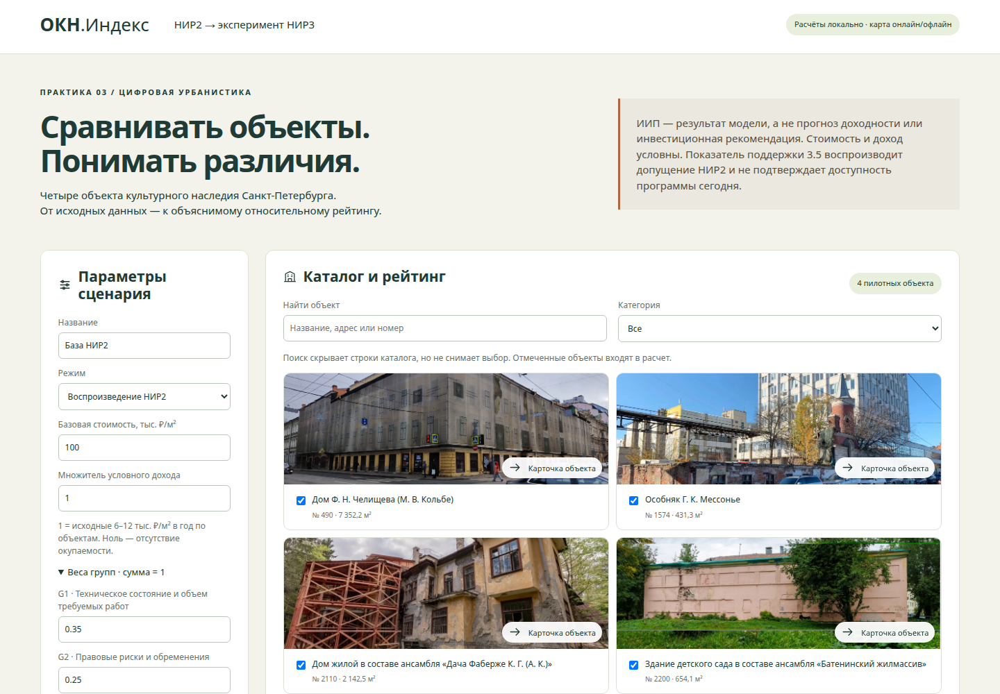
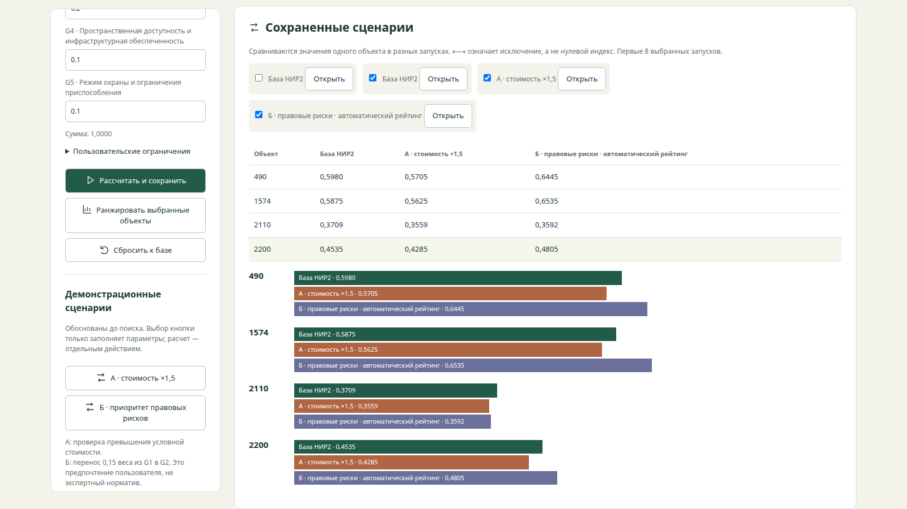
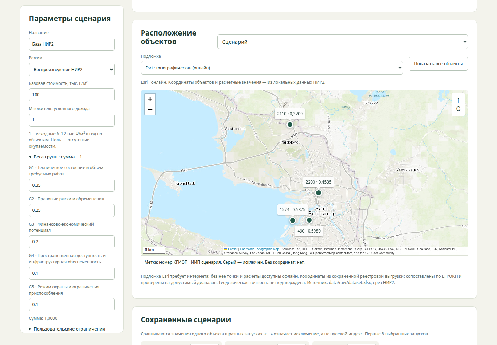

# ОКН.Индекс

Отдельное учебное приложение для сравнения четырех объектов культурного наследия Санкт-Петербурга на основе НИР2 Дениса Яковлева. Практика 3 дисциплины «Технологии искусственного интеллекта в урбанистике», ИТМО, ИДУ, C4207.

**ИИП — относительный результат модели, не прогноз доходности и не инвестиционная рекомендация.** Стоимость и доход заданы условно. Приложение не подтверждает доступность господдержки.



[Короткая видеодемонстрация и субтитры](https://github.com/mfthesun/okn-investment-explorer/releases/tag/v1.0.0) · [Исходное исследование НИР2](https://github.com/mfthesun/nir2-okn-investment-index)

## Быстрый запуск

Требуется Python 3.10+. Для самого приложения сторонние зависимости не нужны:

```bash
git clone https://github.com/mfthesun/okn-investment-explorer.git
cd okn-investment-explorer
python app.py
```

Откройте **http://127.0.0.1:8765**. Остановка — Ctrl+C. Другой порт: `python app.py --port 8766`. Расчеты и данные работают офлайн, без LLM, API-ключей и платных сервисов. Leaflet 1.9.4 поставляется локально, без CDN. Подложка Esri загружается из интернета; режим «Без подложки · офлайн» отключает ее. При недоступности Esri точки и расчеты остаются доступны. Сервер доступен только на этом компьютере; для публичного хостинга не предназначен.

Воспроизводимая проверка в отдельном окружении:

```bash
python -m venv .venv
source .venv/bin/activate  # Windows: .venv\Scripts\activate
python -m unittest discover -s tests -v
python app.py
```

## Пример использования

1. Нажмите «Сбросить к базе»: порядок 490 → 1574 → 2200 → 2110.
2. Выберите объект в карточке: проверьте вклад групп, условный CAPEX, даты и реквизиты источников.
3. Нажмите «А · стоимость ×1,5», прочитайте обоснование, затем «Рассчитать и сохранить».
4. Нажмите «Б · приоритет правовых рисков», затем «Ранжировать выбранные объекты»: первым станет 1574.
5. Выберите 1574 и «Проверить ручным расчетом»: результат совпадет с автоматическим.
6. Сравните базу, А и Б в разделе сохраненных сценариев; лишние запуски можно снять с отображения. Откройте любой сохраненный запуск для восстановления его входов.
7. Экспортируйте JSON и CSV; JSON содержит параметры, выборку и версии. Сброс вернет исходный расчет, сохранив историю.

Поиск и категория скрывают строки каталога, но не снимают выбор объектов. Для ограничения расчетной выборки используйте флажки; площадь и бюджет задаются в пользовательских ограничениях. Изменение формы не пересчитывает показанный результат до нажатия кнопки. Карточка, схема и экспорт относятся к последнему рассчитанному или открытому запуску.



## Что воспроизводится и что добавлено

Неизмененное ядро НИР2 формирует финансовые параметры и индекс из 21 показателя в пяти группах. Базовые итоги в точности до 0,001: 490 — 0,598; 1574 — 0,587; 2200 — 0,454; 2110 — 0,371. Интерфейс показывает четыре знака, экспорт — расчетную точность. Несогласованности утвержденного отчета и правила округления разобраны в [описании метода](docs/method.md).

Экспериментальный задел НИР3: независимые пользовательские сценарии, объяснение вклада групп, прозрачный отбор и 1000 возмущений весов с фиксированным seed. Это не завершенная НИР3. Готовые профили инвесторов, функции приспособления, актуальные льготы и проверка по фактическим инвестиционным результатам отложены.

Сравнение школ «600 мест против двух по 300» заменено двумя сценариями ОКН по индивидуальной устной договоренности **со слов пользователя**, не по опубликованным условиям курса. [Таблица соответствия заданию](docs/practice3-mapping.md) явно перечисляет изменения. Псков остается контекстом предыдущей практики; его файлы не изменены.

## Прежние команды НИР2

```bash
pip install -r requirements.txt
python run_pilot.py
python run_stats.py data/raw/dataset.xlsx
```

`run_pilot.py` не требует зависимостей и формирует таблицы 10–12 в `results/`. Для статистики требуется openpyxl. У `run_stats.py` исторический путь по умолчанию отличается от имени поставляемого файла, поэтому используйте явный аргумент, как выше.

Массив содержит 156 записей; 141 проходит фильтр применимости, 5 исключены, для 10 применимость не устанавливается. Это **не 141 готовый полный индекс**. Достаточный набор показателей подготовлен только для четырех пилотных объектов. Все поиски приложения ограничены ими.

## Структура

| Путь | Назначение |
|---|---|
| `app.py`, `app/` | Локальный сервер и русский интерфейс |
| `src/scoring.py`, `src/finance.py` | Неизмененные формулы НИР2 |
| `src/scenarios.py` | Валидация, сценарии, ранжирование, устойчивость |
| `data/reference/` | Исходные справочники и отдельный слой координат |
| `data/raw/dataset.xlsx` | Ранее опубликованный обезличенный массив |
| `examples/` | База, А, Б, все повторы весового эксперимента |
| `results/runs/` | Локальные запуски, исключены из Git |
| `tests/`, `scripts/browser_check.py` | Проверки ядра и действий пользователя |
| `notebooks/pilot_map.ipynb` | Воспроизводимая схема и PNG |
| `docs/` | Метод, сверка синопсисов, соответствие, проверки, видео |

## Воспроизводимость и проверки

```bash
python -m unittest discover -s tests -v
python scripts/build_examples.py
python scripts/replay.py examples/scenario_a.json
```

Каждый запуск содержит параметры, выбранные объекты, исключения, время UTC, Git HEAD и SHA-256 ядра и справочников. Локальные истории доступны после перезапуска. Для передачи результата используйте JSON вместе с CSV. Команда `build_examples.py` перезаписывает только производные файлы `examples/`.

Браузерная проверка необязательна для запуска:

```bash
pip install -r requirements-dev.txt
python -m playwright install chromium
# В другом терминале: python app.py
python scripts/browser_check.py
```

Можно указать установленный Chrome переменной `BROWSER_EXECUTABLE`. CI проверяет ядро и исходные команды на Python 3.10/3.12/3.14. [Фактические локальные проверки](docs/verification.md) отделены от еще не выполненного удаленного CI.

Карта PNG: `pip install -r requirements-map.txt`, затем `python scripts/render_map.py` или выполнение ячейки ноутбука. Эти зависимости приложению не нужны.

## Источники, полнота и ограничения

Первичный расчетный источник — три справочника НИР2; реквизиты актов приведены в карточках и `pilot_objects.json`. Утвержденный отчет проверен локально, исходный DOCX в репозиторий не добавлен. Даты документов различаются, точная дата общего среза не задана. Давность сведений сохраняется как в НИР2 и не обновляется автоматически на сегодня.

Координаты четырех объектов извлечены из сохраненной выгрузки, сопоставлены по ЕГРОКН и проверены на диапазон; точность положения на местности не подтверждена. Интерактивная карта содержит масштаб, север, подписи, всплывающие карточки и легенду; поддерживает перемещение, приближение и возврат ко всем объектам. Подложка Esri World Topographic Map независима от координат НИР2. Пропуски не заменяются вымышленными точками. Пешеходная доступность в НИР2 задана вручную.

Показатель 3.5 и предел риска 1,60 сохранены для исторического воспроизведения. Их методические ограничения наследуют эксперименты. Актуальные нормативные и финансовые условия не превращаются в автоматический вывод о доступности поддержки. Неполные записи не попадают в полноценный рейтинг, нулевой доход явно означает отсутствие окупаемости.

[Сверка синопсисов](docs/synopsis-review.md) не назначает действующую версию без подтверждения и не меняет утвержденные научные решения.

## Демонстрация и сдача

[Короткая демонстрация](docs/video-demo.md) с русскими субтитрами, без звука. MP4 и SRT доступны в релизе v1.0.0. Публичный веб-деплой не выполняется: репозиторий содержит приложение для локального запуска.

## Лицензия и публикация

Код — MIT, см. `LICENSE`. Справочники, данные и результаты — CC BY 4.0 согласно исходному репозиторию. Новые собственные тексты, автономная схема и оформление — CC BY 4.0 с указанием автора проекта. Leaflet — BSD-2-Clause, лицензия в `app/vendor/LICENSE`. Подложка и ее изображения принадлежат Esri и указанным поставщикам; CC BY проекта на них не распространяется. Атрибуция показана на карте. Сырые акты, утвержденный DOCX, полный экспорт переписки, секреты и окружения не добавлены. Существующая лицензия данных не заменяет проверки прав на будущие новые источники.



Подложка: [Esri World Topographic Map](https://server.arcgisonline.com/ArcGIS/rest/services/World_Topo_Map/MapServer). Проверка доступности и атрибуции: 03.11.2026. Наличие подложки не повышает подтвержденность координат объектов.

## Фотографии, иконки и движение

Четыре фотографии предоставлены автором проекта с платформы **«Наследие» ДОМ.РФ** ([наследие.дом.рф](https://наследие.дом.рф/)). Они показаны в каталоге, карточках и окнах карты; сопоставление и права — в [источниках фото](docs/photo-sources.md). Снимки не ретушировались и не участвуют в расчете индекса. В карточке фотографию можно открыть полностью.

Локальные SVG-иконки дополняют текстовые подписи. Короткие затухающие пружинные анимации работают при смене карточки и обновлении результатов; нет непрерывного движения. Системная настройка `prefers-reduced-motion` отключает анимации интерфейса и карты. Проверки: `python scripts/visual_check.py` и `python scripts/map_check.py` при запущенном приложении. Для нестандартного адреса задайте APP_URL.

[Происхождение приложения и сохраненное авторство](docs/upstream.md). Отдельный репозиторий не изменяет утвержденные решения НИР2/НИР3 и не является официальным продуктом организаций — источников данных.
